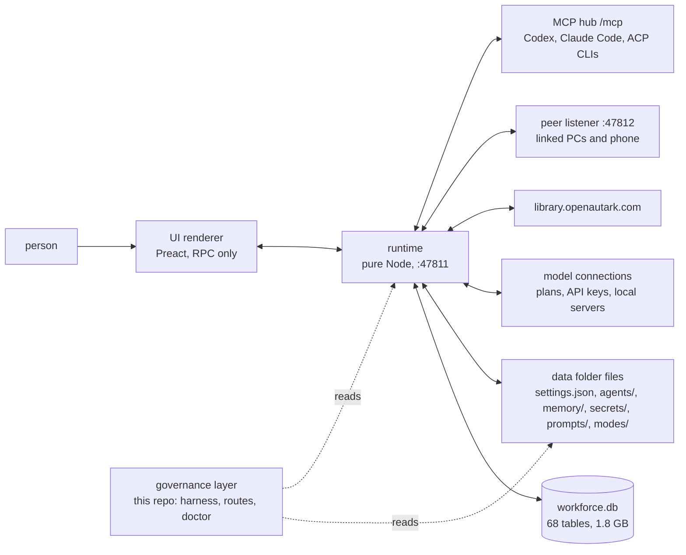
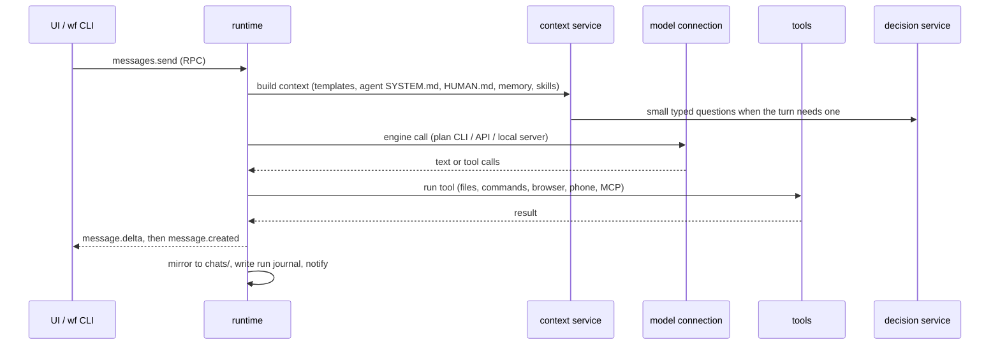

# Architecture notes: OpenAutark, inspected 2026-11-23

Owner: `architecture-notes` (`OWNERS.yaml`). Pass level: **Scan** on the app, **Focus** on the governance boundary.
This file describes the code as it is in this fork (`apps/desktop` at upstream `0.3.19` source) and the install as it
is on this Mac (`/Applications/Autark.app` `0.3.14`, data in `~/Library/Application Support/Autark`). It is not a
redesign. Every finding carries a file path, a measured number or a labelled inference.

Evidence captured with the run: `research/architecture/evidence/` (`loc-layers.txt`, `settings-audit.json`,
`runtime-probe.json`, `install-facts.json`). Re-measure with the commands in section 9 before quoting a number.

## 1. System boundary

Inside: the Electron desktop app (`apps/desktop`), the Android thin client (`apps/android`), the static site
(`apps/website`), the self-hostable meeting server (`services/remote-relay`), the public library service
(`services/library`, Cloudflare Worker + D1), and the skill library entries (`library/`).

Outside, and part of the product's runtime but not its code: the model providers (plan CLIs, API keys, local
servers), the OS keychain, the phone, and `library.openautark.com`. The app's own claims about those connections are
in `README.md` ("Network connections").

Trust boundaries that matter for this layer:

| Boundary | What crosses it | Evidence |
|---|---|---|
| Runtime to UI | RPC only: MessagePort on desktop, WebSocket elsewhere | `docs/ARCHITECTURE.md` §2, `apps/desktop/src/ui/lib/rpc.ts` |
| Runtime to HTTP clients | `:47811` `/rpc`, `/ws`, `/events`, `/mcp`, bearer token in `<data>/runtime.json` | `docs/EXTERNAL_PROTOCOL.md` |
| PC to PC / phone | separate peer listener `:47812`, pinned key, open only while linked | `docs/ARCHITECTURE.md` §2 |
| App to the person's accounts | the app's own security switches (`read, write, commands, web, computer, phone, message, publish, accounts, setup`) with Ask/Allow, plus `ApprovalRequest` | `apps/desktop/src/ui/settings/security-model.ts:1-40`, `src/shared/api/methods-security-mode.ts` |
| Agent to the public library | `library.publish`, redaction and decision checks before send | `library/README.md`, `src/runtime/library/` |

The privileged Windows broker (`resources/broker/install.ps1`) is a source contract only; it is not installed or
verified on this Mac (Not observed for macOS, by design).

## 2. Module map (measured)

| Layer | Files | LOC | Owns |
|---|---|---|---|
| `src/runtime` | 1113 | 151,255 | all state and behaviour; pure Node, never imports electron |
| `src/ui` | 565 | 58,287 | one Preact app for desktop window and PWA; RPC only |
| `src/main` | 100 | 14,788 | window, tray, updates, launcher, protocols, IPC, host services |
| `src/shared` | 146 | 13,889 | pure types, RPC contract, models, generative-UI block catalog |
| `src/preload` | 2 | 283 | `window.workforce` over IPC, argument checks |

77 top-level runtime modules; 86 unit-test areas under `apps/desktop/test/unit`. The layer import rules are
machine-enforced by `apps/desktop/scripts/check-boundaries.mjs` (`npm run boundaries`, part of `npm run check`), which
also enforces a 300-line soft / 450-line hard file cap, orphan detection from `ENTRIES`, an `Owns:` line in every
source file's leading comment, and the `wf` client's own rules. That is the strongest structural guard in this
codebase and the reason this layer does not touch `apps/**`.



## 3. Data flow: one agent turn (as the code describes it)



The governance layer only reads the ends of this flow: `settings.json`, `agents/`, `memory/`, `workforce.db`, and the
runtime's own RPC answers. It adds no runtime module and no turn step.

## 4. Where this repository's layer attaches

Additive data and read-only probes only:

- `harness/gates.py` judges artifacts and payloads (floors F1-F8); it never runs a turn.
- `scripts/doctor.py` reads `settings.json`, `runtime.json`, `agents/`, `memory/`, `secrets/` metadata and
  `workforce.db` (read-only URI), plus one `models.uses` RPC call.
- `routes.yaml` names the nine surfaces and the gate command for each.
- `blueprints/openautark-os-architect.json` maps the lifecycle stages to the pattern catalog.
- `autark-os/` (another owner) is data in the app's own format: agents, skills, memory files.

None of this imports from `apps/**`, and nothing here is loaded by the runtime. The runtime boundary
(`runtime` never imports `electron`, `ui` only speaks RPC) is unchanged by this layer.

## 5. Debt register

| # | Severity | Finding | Evidence | Smallest safe correction |
|---|---|---|---|---|
| D1 | **High** | One provider carries a literal bearer token in `settings.json` while every other credential is a `secret://` reference. Anyone who reads the data folder, a backup, or a support bundle reads the token. | `research/architecture/evidence/settings-audit.json` -> `raw_credential_locations: ["providers.aside-gemini.models[google-antigravity/gemini-4-carbon].headers.Authorization"]`; the reference contract is `apps/desktop/src/ui/settings/apps-files.ts:88` (`Bearer secret://<id>`) | Store the value in Settings › Secrets, set that header to `Bearer secret://<id>`, then rotate the exposed token. Principal action: it is account material. `scripts/doctor.py` reports this as a failure today. |
| D2 | Medium | Decisions can fall back to a cheap LLM: with no decision model configured, `decision/llm-fallback.ts` answers the same typed question at low effort and escalates once at medium. A verdict that depends on a judge can therefore be produced by a non-judge. | `apps/desktop/src/runtime/decision/llm-fallback.ts:1-11` | Keep `routing.decision` pinned to the declared classifier (live: `typesafe:jev-latest`, `runtime-probe.json`). Doctor checks it and warns when it is `auto`; promote to a failure once the Principal agrees. |
| D3 | Medium | `library.publish` defaults to **true**. A new company is a new data folder with defaults, so a second company starts publishing skills to the public library. The live install has it off. | `apps/desktop/src/runtime/settings/schema.ts:177`; live value `false` in `settings-audit.json` | Keep `false`; check every company folder, not only the first. Doctor currently reads the first company only (open question Q2). |
| D4 | Medium | The installed app is `0.3.14`; the fork's source is `0.3.19`. Secure mode, the `security` settings section and `ApprovalRequest` exist in source, not in the running app. Any floor that assumes them overstates the live guard. | `/Applications/Autark.app` `CFBundleShortVersionString 0.3.14`; `apps/desktop/src/runtime/bridge/sicher-1119.ts:1-12` (migration dated 19.11.2026); doctor reports `secure_mode_switches: "absent"` | Update the app to the release that carries the security section, then re-run the doctor and require the section. Until then F4 is enforced on `profile.pcAccess` only. |
| D5 | Low | `pcAccess` changed shape across versions: `profile.pcAccess` (<= 0.3.14) became the `security` section (>= 0.3.19). A script reading one shape silently reads `undefined` on the other. | `apps/desktop/src/runtime/bridge/sicher-1119.ts:106-120`, `apps/desktop/src/shared/model/security-log.ts:11-17` | `harness/gates.py:pc_access` accepts both shapes and says which one it saw; version it in the proof packet. |
| D6 | Low | Update integrity is upstream: `main/updates/*` (electron-updater plus a macOS self-updater) is outside this layer, so the repository cannot verify a downloaded artifact. | `docs/ARCHITECTURE.md` §2 (`updates/*`), `README.md` (Checksums, `SHA256SUMS.txt`) | The proof packet records the release file and its SHA-256 when an update is part of a run; never claim the app verified a signature it did not. |
| D7 | Low | The runtime is 151k LOC across 1113 files held together by a 300/450-line cap and an `Owns:` convention. Healthy, but it means a governance change must never add a runtime module: a file without an `Owns:` line or unreachable from `ENTRIES` fails `npm run boundaries`. | `apps/desktop/scripts/check-boundaries.mjs:1-40` | Keep governance in the root contract files and `harness/`, `scripts/`, `tests/`, as this layer does. |
| D8 | Low | The doctor's default data path is macOS-specific (`~/Library/Application Support/Autark`); a Windows or Linux install must set `AUTARK_DATA`. | `scripts/doctor.py` `DATA` constant | Documented in `harness/README.md`; set the variable in CI or on another OS. |

## 6. Open questions

- **Q1:** Should `routes.yaml` grow a per-agent freshness contract (429 agents, runs journaled in `workforce.db`)? The
  job-search-os equivalent has a schedule and a receipt per bot. Nothing here yet decides what "stale" means for an
  agent that is idle by design.
- **Q2:** Should the doctor walk every company folder (`~/Library/Application Support/Autark Companies/<id>`) rather
  than the first? Only `logins/` exists there today, so the question is deferred, not answered.
- **Q3:** Which enforcement point owns Gate-D at runtime? Source (>= 0.3.19) has `ApprovalRequest`/`ApprovalAnswer`
  and the `message`/`publish` switches with Ask; the installed build has neither. Until the update lands, Gate-D is an
  artifact contract here (this repo) plus agent instructions, not a runtime interrupt. That gap is exactly why the
  harness holds payloads rather than trusting a run.
- **Q4:** Does `library.publish` redaction cover hostnames and paths on every route (`library/README.md` says it does)?
  Not verified against the running service; treated as a claim, not a control.

## 7. Risk register

| Risk | Likelihood | Impact | Existing control |
|---|---|---|---|
| A raw credential read from the data folder or a backup (D1) | Medium | High | `doctor.py` fails on it; rotate and reference |
| A verdict produced by a fallback model (D2) | Medium | High | `routing.decision` pinned; `jev_verdict` refuses non-hosted sources |
| Skills leaving the PC from a second company (D3) | Low | Medium | doctor checks `library.publish` on the first company |
| Overstating the guard because source is ahead of the build (D4) | High today | Medium | doctor reports "absent"; this note dates both versions |
| An agent sending outward on instruction-level trust (Q3) | Medium | High | Gate-D artifact contract; `requires_gate_d` and `lane_allowed` |

## 8. Validation gate (three questions)

1. **What did I inspect?** `docs/ARCHITECTURE.md`, `docs/EXTERNAL_PROTOCOL.md`, the `apps/desktop` tree
   (measured LOC per layer), `scripts/check-boundaries.mjs`, `src/runtime/settings/schema.ts`,
   `src/runtime/decision/llm-fallback.ts`, `src/runtime/bridge/sicher-1119.ts`, `src/ui/settings/security-model.ts`,
   `src/ui/settings/apps-files.ts`, the live `settings.json`, `runtime.json`, `models.uses` answer, `agents/`,
   `memory/`, `secrets/` metadata, and `workforce.db` table count.
2. **What is inferred?** That `0.3.19`'s security section is the same contract the next release ships (the README says
   so; the migration file says so; the installed build does not have it). That `approval` in `ApprovalRequest` can carry
   Gate-D (the type exists; wiring it to this harness is proposed, not observed).
3. **What is not observed?** The Windows broker's behaviour; the library service's live redaction; phone pairing on a
   real device; any agent's runtime obedience to a floor; per-company settings beyond the first.

## 9. Re-measure

```sh
# layer size (the numbers in section 2)
for d in src/shared src/runtime src/main src/preload src/ui; do
  printf "%-14s %s\n" "$d" "$(find apps/desktop/$d -name '*.ts' -o -name '*.tsx' | wc -l) files"
done

# live install: doctor (read-only) and the two suites
python3 scripts/doctor.py
node --test tests/*.test.mjs && python3 -m pytest -q tests

# structural guards upstream keeps
cd apps/desktop && npm run boundaries
```
